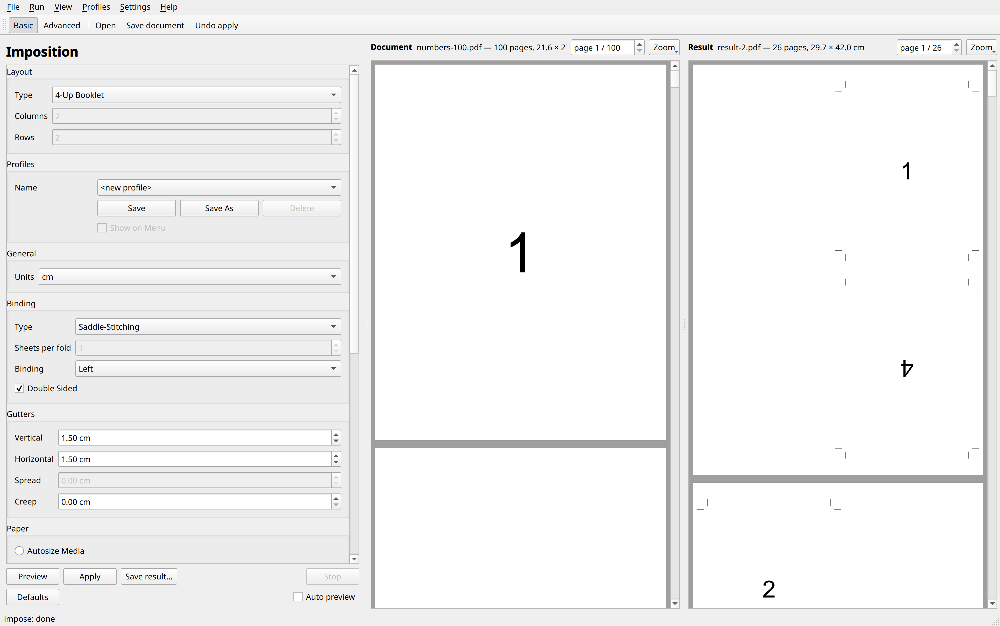
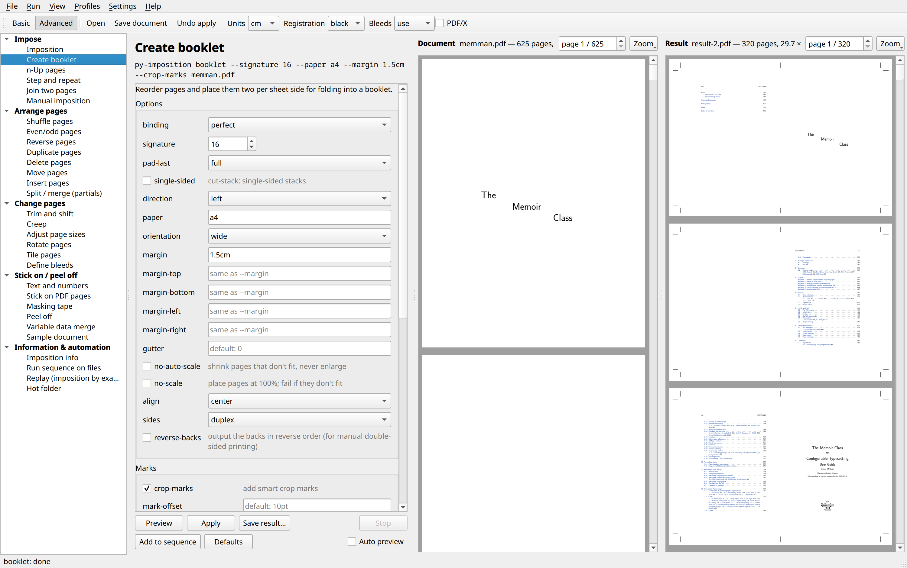
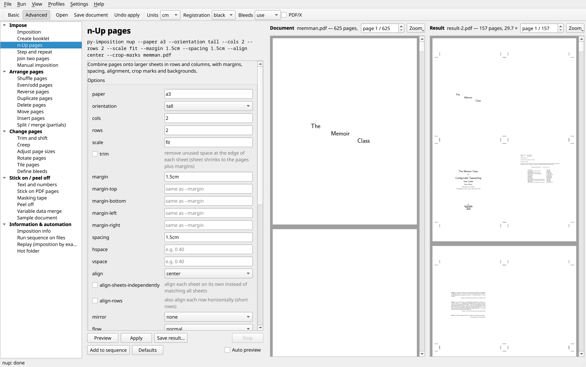
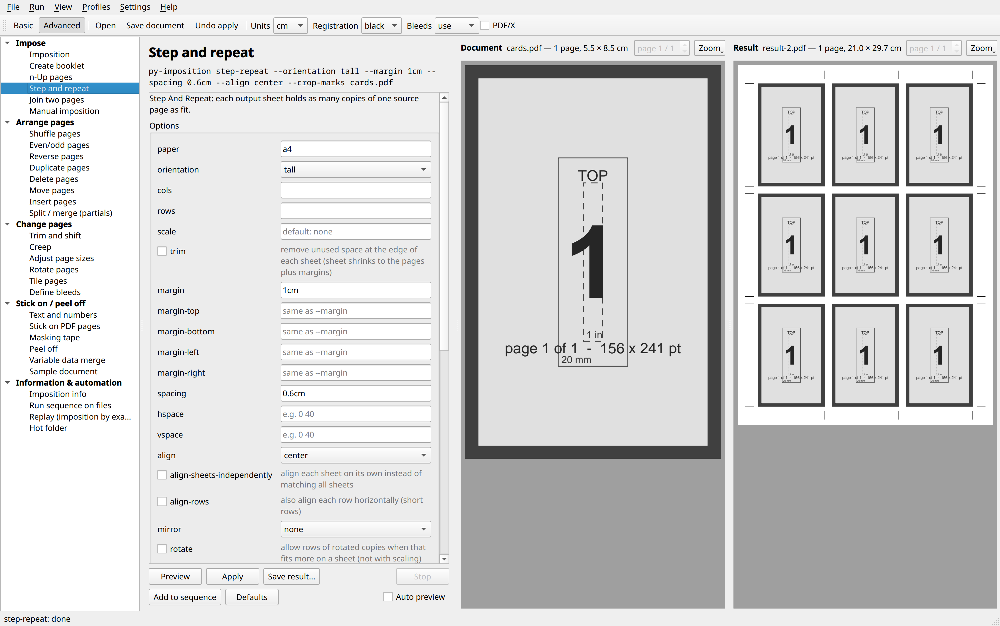
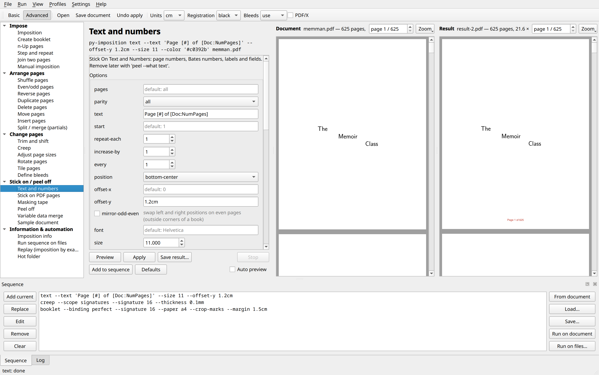
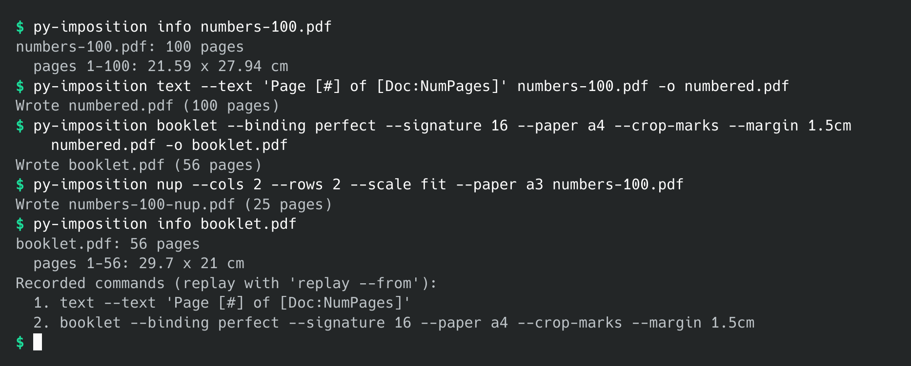

# py-imposition

*(Español: [README_es.md](README_es.md))*

A command-line PDF imposition toolkit: booklets, n-up, step and repeat, page
shuffling, trimming and shifting, creep, bleeds, page numbers and stamps,
masking tape, manual imposition, variable data merge, split/merge (partials),
automation sequences and hot folders.

Every command reads a PDF and writes a new one. Commands can be chained by
running them one after another, or saved as a **sequence** and run in a
single go. There is also a graphical interface with live previews.

## Screenshots

The window in basic mode: one imposition form, here a 4-up saddle-stitched
booklet of [`docs/example/numbers-100.pdf`](docs/example/README.md):



In advanced mode, the window, making a perfect-bound booklet in 16-page signatures from the
example book ([`docs/example/memman.pdf`](docs/example/README.md)):



4-up on A3 with crop marks:



Step and repeat (business cards):



Adding page numbers, with a sequence of commands ready in the Sequence panel:



The command line:



These pictures are made by `uv run python tools/screenshots.py` (see
[Development](#development)).

## Installation

There are three ways to install it: the AppImage (nothing to install), the
Fedora package, or from the source.

### AppImage (any Linux)

Download `py-imposition-VERSION-x86_64.AppImage` from the
[releases](https://github.com/nivaca/py-imposition/releases), make it
executable, and run it. It holds its own Python, Qt and everything else, and
runs on Linux with glibc 2.34 or later (Ubuntu 22.04, Debian 12, Fedora 35 and
later).

```bash
chmod +x py-imposition-*-x86_64.AppImage
./py-imposition-*-x86_64.AppImage                    # the window
./py-imposition-*-x86_64.AppImage booklet in.pdf     # the command line
./py-imposition-*-x86_64.AppImage cli --help         # the list of commands
```

A first argument that is a command (`booklet`, `nup`…), an option, or `cli`
runs the command line; anything else, or nothing, opens the window. Tools
such as AppImageLauncher or Gear Lever add it to the applications menu.

### Fedora (Copr)

```bash
sudo dnf copr enable nivaca/py-imposition
sudo dnf install py-imposition
```

This installs `py-imposition`, `py-imposition-gui`, a menu entry (also
offered for opening PDF files) and the icons, using Fedora's own Python,
pikepdf, reportlab and PySide6. Updates come with `sudo dnf upgrade`. The
packages are built and signed by
[Copr](https://copr.fedorainfracloud.org/coprs/nivaca/py-imposition/).

Each release also has the RPM itself, signed with the author's key, and that
key (`RPM-GPG-KEY-py-imposition`):

```bash
sudo rpm --import RPM-GPG-KEY-py-imposition
sudo dnf install ./py-imposition-*.noarch.rpm
```

### From the source

You need Python 3.12+ and [uv](https://docs.astral.sh/uv/).

```bash
git clone <repo-url> py-imposition
cd py-imposition
uv sync
uv tool install .        # optional: makes `py-imposition` available everywhere
```

For the graphical interface, include the `gui` extra:

```bash
uv sync --extra gui
uv tool install '.[gui]'   # installs both py-imposition and py-imposition-gui
```

Dependencies: [pikepdf](https://pikepdf.readthedocs.io/) (based on QPDF)
and [reportlab](https://www.reportlab.com/) (text and fonts). The GUI also
needs [PySide6](https://doc.qt.io/qtforpython-6/) (Qt 6): the
`pyside6-essentials` and `pyside6-pdf` packages, about 250 MB.

### A menu entry

To start the window from the applications menu, run once

```bash
py-imposition-install          # or: uv run py-imposition-install, python -m py_imposition.install
```

This adds an entry, with the program's icon, that starts the window with the
same Python that ran the installer. Where it goes depends on the system:

* **Linux** (and other systems with freedesktop menus): in the applications
  menu, as a `.desktop` file and icons in `~/.local/share`. The entry also
  offers py-imposition in the *Open with* menu of PDF files.
* **Windows:** in the Start menu, as a shortcut.
* **macOS:** in `~/Applications`, as a small application.

It doesn't need administrator rights. If the Python environment moves or is
rebuilt (for example, after `uv tool install` again into a new place), run it
again. It needs the `gui` extra, and says so if PySide6 is missing.

### Uninstalling

```bash
py-imposition-install --uninstall   # remove the menu entry and its icons
uv tool uninstall py-imposition     # if installed with uv tool
```

`--uninstall` removes only what the installer added: the entry and the
`py-imposition` icons in every size. Settings of the window are kept by Qt in
`~/.config/py-imposition/` (Linux), the registry (Windows) or
`~/Library/Preferences` (macOS); delete them too if you like.

## Quick start

The repository includes a real book to try things on:
[`docs/example/memman.pdf`](docs/example/README.md), the 625-page manual of
the LaTeX *memoir* class.

```bash
py-imposition info docs/example/memman.pdf
py-imposition booklet --signature 16 --paper a4 --crop-marks --margin 1.5cm docs/example/memman.pdf
py-imposition-gui docs/example/memman.pdf
```

In general:

```bash
# 2-up booklet with the default settings
# (perfect binding, 4 pages per fold, left binding, Legal landscape, no margins, auto scale)
py-imposition input.pdf                      # writes input-booklet.pdf

# any command: py-imposition COMMAND [options] INPUT [-o OUTPUT]
py-imposition booklet --binding saddle --paper a4 input.pdf -o booklet.pdf
py-imposition nup --cols 2 --rows 2 --scale fit --crop-marks input.pdf
py-imposition text --text "Page [#] of [Doc:NumPages]" input.pdf

py-imposition --help                 # list commands
py-imposition booklet --help         # options of one command
```

Without `-o`, output goes to `<input>-<command>.pdf`. Commands that produce
several documents (for example `--sides separate`) add a suffix such as
`-fronts`/`-backs`.

## Graphical interface

```bash
py-imposition-gui [file.pdf]        # or: uv run py-imposition-gui
```

A switch at the top left of the window chooses between two modes; the window
remembers the last one.

**Basic mode** is a single imposition form with the usual options, laid out
like a common imposition dialog. It runs the [`impose`](#impose--imposition)
command:

- **Layout:** the type (2-, 4- or 8-up booklet, cut stacks, sequential, step
  and repeat), and the columns and rows for the last three.
- **Profiles:** save the settings under a name (*Save*, *Save As*), *Delete*
  them, and tick *Show on Menu* to put a profile in the *Profiles* menu for
  quick access.
- **General:** the units.
- **Binding:** saddle-stitching or perfect binding, the sheets per fold, the
  binding edge (left or right) and *Double Sided*.
- **Gutters:** vertical, horizontal, the spread between the middle columns of
  an 8-up booklet, and the creep.
- **Paper:** *Autosize Media* (the sheet fits the pages), or *Fit to Media
  Size* with a standard or custom size and portrait or landscape;
  *Auto-rotate* and *Auto Scale* (shrink pages that are too large).
- **Margins:** top, bottom, left and right.
- **Printer Marks:** trim marks, bleed marks, registration marks and page
  information.

Options that don't apply to the chosen layout are greyed out. The previews,
*Apply*, *Undo apply* and the saving of documents and results work as in
advanced mode.

**Advanced mode** offers every command of the CLI:

- **Commands** are listed on the left, grouped like the sections below.
- **Options** for the selected command appear as a form generated from the
  same definitions as the command line, so names, defaults and help (in
  tooltips) match. The equivalent command line is shown above the form; copy
  it with *Run ▸ Copy command line*. Options that exclude each other clear
  each other. *Reference* expands the layout/fields/sequence file formats
  for `manual`, `merge-data` and `run`.
- **Previews:** the current document and the result are shown side by side.
  With *Auto preview* on, the result updates shortly after each change. A
  drop-down switches between results when a command produces several files
  (e.g. separate fronts and backs).
- **Apply** makes the result the current document, so you can chain
  commands (number pages, then make a booklet, then add crop marks…).
  *Undo apply* (Ctrl+Z) steps back, and *File ▸ Revert to original* starts
  over. *Save document* saves the current document, and *Save result* saves
  the last result.
- **Preferences** (units, registration colour, bleed handling, PDF/X) are
  on the toolbar and apply to every command. The language is under
  *Settings ▸ Language of the interface*.
- **Sequence panel:**
  - Collect steps from the form (*Add current*), or reorder them by dragging.
  - Load steps from a document's recorded commands (*From document*, i.e.
    imposition by example).
  - Load and save sequence files.
  - Run the steps on the current document (with preview), or on a batch of
    files.
- **Info, run and hot folders:** *Imposition info* opens a report, and
  *Hot folder* starts and stops a `watch` process. All commands run in a
  background process, so the window stays responsive. *Stop* (Esc) cancels a
  run, and the *Log* tab shows each command line and its output.
- Drop a PDF on the window to open it. Window layout, preferences, the
  options of each command and the sequence are remembered between sessions.

## The language of the interface

py-imposition speaks English or Spanish: the help of every command and
option, its messages, and the window's menus, buttons, labels and help. The
results (the PDFs) are the same in both.

- **To choose the language for good:** run `py-imposition interface es` (or
  `en`), or use *Settings ▸ Language of the interface* in the window. The
  window changes at once.
- **Running `py-imposition interface` with no language** lists the available
  languages and shows the one in use.
- **For one run only:** add `--interface es` to any command.

The choice is kept in a small configuration file, `config.toml`, in
`~/.config/py-imposition/` (Linux), `~/Library/Application
Support/py-imposition/` (macOS) or `%APPDATA%\py-imposition\` (Windows);
`$PY_IMPOSITION_CONFIG` names another folder. Both the command line and the
window read it.

The translations are in `src/py_imposition/locale/es.xml`, with one `<text>`
for each text of the program, giving the English (`<en>`) and its
translation (`<tr>`). To add another language, make a file for it (`fr.xml`,
for example); what it doesn't translate is shown in English. Qt's own
dialogs, such as file choosers, follow the same language.

## General conventions

**Lengths** take a unit suffix: `5mm`, `1.5cm`, `0.25in`, `12pt`. Simple
fractions work too (`3/8in`). Bare numbers use the current unit, which is
centimetres unless `--units` says otherwise.

**Paper sizes** are names (`letter`, `legal`, `tabloid`, `ledger`,
`executive`, `statement`, `a0`–`a6`, `b4`, `b5`, `sra3`, and `max` for
200 × 200 in) or explicit sizes (`21x29.7cm`, `9x14in`). Orientation is
`tall`/`portrait`, `wide`/`landscape`, `best` (n-up and step and repeat
choose whichever fits more) or `as-is`.

**Page ranges** look like `all`, `odd`, `even`, `1-4,7`, `3..LAST`,
`LAST-1`. `LAST` is the last page. Many commands also take
`--parity odd|even`.

**Preferences** are accepted by every command:

| Option | Meaning |
|---|---|
| `--units cm\|mm\|in\|pt` | unit for bare numbers (default `cm`) |
| `--registration black\|cmyk\|all` | colour of crop marks and "registration" text: black only, CMYK (all four process plates), or all separations |
| `--bleed use\|ignore` | use pages' bleed boxes when imposing (default), or impose the visible page only |
| `--pdfx` | when bleeds are removed, keep a TrimBox (PDF/X) |
| `-q` | no warnings |
| `--interface en\|es` | the language of the interface, for this run only (see [The language of the interface](#the-language-of-the-interface)) |

**Page boxes and bleeds.** Imposition lines up each page's *trim box*. If a
bleed box is defined, artwork shows beyond the trim. Bleeds are clipped so
they never run into neighbouring pages, and crop marks align with the trim.

## Commands

### Imposing onto sheets

#### `impose` — Imposition

All the usual impositions in one command, with the options of the window's
basic mode:

| Option | Description |
|---|---|
| `--layout 2up-booklet\|4up-booklet\|8up-booklet\|cut-stacks\|sequential\|step-repeat` | 2 pages side by side; 2 rows of 2; 2 rows of 4; cut stacks; pages in order; copies of each page (default: `2up-booklet`) |
| `--cols`, `--rows` | the grid of cut stacks, sequential and step and repeat (default: 2 × 2) |
| `--binding saddle\|perfect`, `--sheets-per-fold N` | saddle-stitching, or perfect binding in stacks of N folded sheets (default: perfect, 1) |
| `--direction left\|right`, `--single-sided` | the binding edge; print on one side only |
| `--gutter-v`, `--gutter-h`, `--spread`, `--creep` | space between columns and rows; between the middle columns of an 8-up booklet; creep for the paper's thickness |
| `--media SIZE\|auto`, `--orientation portrait\|landscape` | the sheet: a paper name or WxH, or `auto` to fit the pages (default: Legal landscape) |
| `--auto-rotate`, `--no-auto-scale` | turn pages to fit their cells; don't shrink large pages |
| `--margin…` | margins |
| `--trim-marks`, `--bleed-marks`, `--registration-marks`, `--page-info` | printer marks; page information is the document name, sheet number, date and time |

The 4- and 8-up booklets use the standard folding layouts: fold each sheet,
then nest the folded sheets (saddle-stitching) or stack them in groups of
`--sheets-per-fold` (perfect binding).

```bash
py-imposition impose --layout 4up-booklet --binding saddle --media a3 --orientation portrait --trim-marks --margin 1.5 doc.pdf
py-imposition impose --layout step-repeat --cols 2 --rows 5 --media a4 --orientation portrait --trim-marks cards.pdf
```

#### `booklet` — Create booklet

Reorders pages and puts two on each side of a sheet for folding.

| Option | Description |
|---|---|
| `--binding perfect\|saddle\|continuous\|cut-stack` | **perfect**: separate folded signatures, stacked (default). **saddle**: all sheets nested in one fold. **continuous**: 1,2 \| 3,4 … (not folded). **cut-stack**: cut the sheets in half and put one stack on the other. |
| `--signature N` (`--pages-per-fold`) | pages per signature for perfect binding (multiple of 4, default 4) |
| `--pad-last full\|multiple-of-4` | pad a short last signature to full length, or only to a multiple of 4 |
| `--single-sided` | single-sided cut stacks |
| `--direction left\|right` | binding edge (right for right-to-left books) |
| `--paper SIZE`, `--orientation` | sheet (default Legal, wide). `--paper auto` makes the sheet exactly two pages wide. |
| `--margin…`, `--gutter` | space at the edge of the sheet, and between the two pages |
| `--no-auto-scale` / `--no-scale` | never enlarge / place at 100% (fail if pages don't fit) |
| `--align center\|fold` | centre each page in its half, or pull pages to the fold/spine |
| `--sides duplex\|flip-backs\|fronts-then-backs\|separate`, `--reverse-backs` | output for single-sided printers: backs upside down, all fronts then all backs, or two files |
| `--crop-marks` (+ mark options) | crop and fold marks |

All pages are scaled by the same factor, based on the largest page. Print
the result double-sided, flipping on the short edge.

#### `nup` — n-Up Pages

Places pages left to right, top to bottom, on larger sheets.

| Option | Description |
|---|---|
| `--cols`, `--rows` | layout: maximums at 100%, or exact with `--scale fit` |
| `--scale none\|fit\|PERCENT` | 100%, fit exactly cols × rows (based on the first page), or a percentage |
| `--paper`, `--orientation best` | sheet size; `best` chooses tall or wide to fit more pages |
| `--trim` | remove unused space at the edge of each sheet |
| `--margin…`, `--spacing`, `--hspace "0 40"`, `--vspace` | margins, and spacing between columns and rows. Lists repeat. |
| `--align top-left\|…\|center` | where pages sit on sheets that aren't full |
| `--align-sheets-independently`, `--align-rows` | align each sheet on its own; align short rows too |
| `--mirror h\|v\|hv` | mirror margins and alignment on even (back) sheets |
| `--flow normal\|double\|double-flip` | fill sheets in turn, or alternate front/back sheets with the backs in mirrored positions (optionally upside down) |
| `--crop-marks`, `--frames`, `--mark-offset/-length/-width`, `--mark-white-background` | smart crop marks (they never overlap pages and become fold marks where needed), and frames |
| `--background PDF`, `--background-pages`, `--background-mode repeat\|once\|repeat-last` | impose onto background pages (templates, colour bars) |

Useful recipe: `nup --cols 1 --rows 1 --paper max --trim --margin 1 --crop-marks`
adds margins and crop marks around every page.

#### `step-repeat` — Step And Repeat

Fills each sheet with copies of one page (business cards, labels). It takes
the same layout options as `nup`, plus `--rotate`, which adds rows of rotated
copies when that fits more. A 5 × 2 in card on a 9 × 14 in sheet gives 7/8
copies (tall/wide) without rotation and 10/11 with it. To make fronts and
backs line up, combine `--rotate --align-rows --mirror h`.

#### `join` — Join Two Pages

`--first N` joins page N with N+1 side by side; `--all` joins every pair.
Margins are unchanged.

#### `manual` — Manual Imposition

Places pages at exact positions, driven by a TOML layout file:

```toml
sheet = "a3"
orientation = "wide"
sides = "double-h"        # single | double-h | double-v (backs mirrored automatically)
repeat = true             # repeat the layout until all pages are placed
crop_marks = true

[[place]]
side = "both"             # front | back | both (next page on the front, the one after on the back)
corner = "top-left"       # offsets go from this corner of the sheet to the same corner of the page
x = "2cm"
y = "2cm"
scale = 60                # percent
rotate = 0                # clockwise
# page = 3                # optional fixed page instead of "the next one"
```

Also accepts `background = "plate.pdf"` and `sheets = N` (sheets per cycle),
plus `--smart-marks` on the command line. See `py-imposition manual --help`.

### Arranging pages

#### `shuffle` — Shuffle Pages For Imposing

Reorders and rotates pages by a rule that repeats over the document. It is
usually followed by `nup`.

- `--rule` lists page numbers for one group. `a..b` is a range, `X` a blank
  page. Suffixes: `*` upside down, `>` 90° clockwise, `<` 90° anticlockwise.
- `--group N` is the group size (default: the highest number in the rule).
- `--repeat normal` repeats every group (perfect bound).
- `--repeat saddle`: the rule describes the first sheet of a saddle-stitched
  book and stretches to any length (`--rule "4 1 2 3"`).
- `--repeat cut-single`, `--repeat cut-double`: cut stacks printed on one or
  both sides. With `--consecutive A` and `--restart-after B` they make the
  "advanced stacks (A,B)", e.g. numbered ticket books.

```bash
# 4-up saddle-stitched booklet: shuffle, then 2 x 2 n-up
py-imposition shuffle --rule "8 1 5* 4* 2 7 3* 6*" --repeat saddle in.pdf -o s.pdf
py-imposition nup --cols 2 --rows 2 --scale fit --paper a3 s.pdf
```

#### `evenodd` — Shuffle Even/Odd Pages

`--mode odds-first` (default), `split` (two files), `join --evens FILE`
(interleave two documents) or `none`. Add `--reverse-evens` and
`--rotate-evens` for manual double-sided printing.

#### `reverse`, `duplicate`, `delete`, `move`

```bash
py-imposition reverse in.pdf
py-imposition duplicate --copies 2 [--no-collate] [--pages 1-3] in.pdf
py-imposition delete --pages "1,LAST" in.pdf
py-imposition move --pages 9-10 --before 1 in.pdf
```

#### `insert` — Insert Pages

- **What:** `--blank N` or `--file PDF [--file-pages] [--copies] [--no-collate]`.
- **Where:** `--before`/`--after PAGE` (e.g. `LAST-1`) or `--at start|end`.
- **Blank page size:** `--size`/`--size-of`.
- **Intervals:** `--every K` inserts, then skips K pages, and repeats.
  `--each-time N` takes the next N pages of the file each time.
- **Conditions:** `--if` / `--unless` / `--until`, with `odd`, `even`,
  `lt:N`, `ge:N` or `multiple:N`.
- **New document:** without an input, it creates one.

```bash
# blank pages before the back cover until the page count is a multiple of 4
py-imposition insert --blank 999 --after LAST-1 --until multiple:4 in.pdf
# insert notes.pdf at the end until a multiple of 32 pages
py-imposition insert --file notes.pdf --copies 999 --until multiple:32 in.pdf
```

#### `split` — Split/merge (partials)

Splits by `--by odd-even|list|equal|duplicates`, runs different commands on
each part, then merges the parts (`--merge`) or keeps them as separate files.

```bash
# number each 16-page part from 1 again (number.toml: steps = ["text"])
py-imposition split --by equal --size 16 --sequence number.toml --merge in.pdf
# partials: different layouts for different parts
py-imposition split --by list --list "1..8; 9..16; 17..20" \
  --part-sequence 1=nup4x2.toml --part-sequence 2=nup4x2.toml --part-sequence 3=nup2x2.toml in.pdf
```

`--list` accepts `LAST`, ranges, rotation suffixes and `X`. Per-part commands
come from `--sequence FILE` (all parts), `--part-sequence N=FILE`, or
`--part-steps "N=cmd ...; cmd ..."`.

### Changing pages

#### `trim-shift` — Trim And Shift

- `--trim EDGE=LEN` and `--add EDGE=LEN` take left, right, top, bottom or
  all, and can be repeated.
- `--same-size SIZE` makes every page the same size.
- `--shift DIR=LEN` shifts by a fixed amount; `--shift-variable DIR=FIRST:LAST`
  varies the shift from the first page to the last.
- `--mode improved` (default) never uncovers cropped content; `--mode original`
  moves the page origin instead.
- `--keep-bleed` keeps the bleed margins.

Use `--pages`/`--parity` for binding offsets on odd and even pages.

#### `creep` — Creep pages for binding

Shifts (or, with `--method scale`, squeezes) page contents to compensate for
paper thickness in folded booklets. Set the amount with
`--thickness 0.1mm` or `--total 2mm`. Choose
`--scope document|signatures --signature N` and
`--shift-most inside|outside`. Run it before `booklet`.

#### `resize` — Adjust Page Sizes

- **Target:** `--size SIZE` (with `--orientation`), `--percent P` or
  `--same-as PAGE`.
- **Method:** `--method anamorphic|proportional|none`.
- **Other options:** `--rotate-to-fit cw|ccw`, `--only enlarge|shrink`,
  `--similar TOL` (only adjust pages close to the target size), and
  `--keep-bleed` (anamorphic).
- **Checking:** `--verify` reports pages of the wrong size without changing
  anything.

#### `rotate`

`--angle 90|180|270` sets the page rotation. Any other angle rotates the
contents freely and enlarges the page, unless you pass `--keep-size`.
`--crop-first` crops to the visible page before rotating. `--only tall|wide`
picks up stray pages.

#### `tile` — Tile Pages

- `--grid 2x1` splits each page into a grid; `--sizes "4in 4.5in / 4in 3in"`
  uses exact tile sizes.
- `--overlap LEN` overlaps the tiles, and `--overlap-bleed` turns the overlap
  into bleed.
- `--only-wide` splits only reader's spreads.
- `--undo-booklet saddle|perfect` cuts an imposed 2-up booklet back into
  single pages in reading order.

#### `bleed` — Define bleeds

- **Modes:** `--mode all|except-fold|edges|from-crop|remove|generate-only`.
  The amount is `--amount 3mm`, or `--left/--right/--top/--bottom` with
  `--mode edges`.
- **Where the bleed comes from:** inside the visible page by default, or
  `--outside` (from previously cropped content).
- **Missing artwork:** `--generate mirror|scale` creates content for the
  bleed area, drawn behind the page.
- **Display:** `--show` sets the crop box to the bleed box.

### Sticking things on (and peeling them off)

#### `text` — Stick On Text and Numbers

```bash
py-imposition text in.pdf                                   # page numbers, bottom centre
py-imposition text --text "Page [#] of [Doc:NumPages]" --position bottom-right --offset-x 1cm --mirror-odd-even in.pdf
py-imposition text --start 000123 --position top-right in.pdf     # Bates numbering, leading zeros kept
py-imposition text --text "Plate [Page]" --color registration --registration all imposed.pdf
```

- **Placeholders:** `[#]` is the number. Fields: `[Doc:NumPages]`, `[Page]`,
  `[Date]`, `[Date:mdy]`, `[Date:iso]`, `[Time]`, `[DateTime]`,
  `[File:Name]`, `[File:Path]`, `[File:Folder]`, `[Doc:Title]`, `[Computer]`.
- **Numbering:** `--start`, `--repeat-each N` (1,1,1,2,2,2), `--increase-by N`
  (may be negative), and `--every N` (stamp only every N-th page).
- **Position:** `--position` (corners, top/bottom centre, left, right,
  centre), `--offset-x`, and `--offset-y` (measured to the text baseline).
  `--rotation 0|90|180|270`.
- **Font:** `--font` is a standard PDF font (Helvetica, Times-Roman,
  Courier…), a TrueType file, or an installed font name. Installed fonts are
  embedded.
- **Size and colour:** `--size`. `--color` takes `black`, `red`, `#rrggbb`,
  `rgb:R,G,B`, `cmyk:C,M,Y,K` (percent), `gray:P` or `registration`.

#### `stick-pdf` — Stick On PDF Pages

Adds pages of another PDF (logos, stamps, adverts):

- `--file F --source-pages RANGE` picks the source pages, which cycle over
  the target pages.
- `--position`, `--offset-x/-y` place it, measured from the chosen corner,
  edge or centre.
- `--scale P` or `--fit WxH [--stretch]` sets the size; `--rotate` turns it.
- `--under` puts it behind the page content.

#### `mask` — Stick On Masking Tape

`--rect X,Y,W,H` (repeatable) covers areas, measured from the
`--origin bottom-left|top-left` of the visible page, in `--color` (white by
default). Use it to hide old page numbers before adding new ones.

#### `peel` — Peel Off Text and Numbers / Masking Tape / Registration Marks

`--what text|tape|marks|pdf|bleed|all` removes items added by this tool.
That works even after the pages have been imposed onto sheets.

#### `merge-data` — Variable data merge

Takes a CSV/TSV data source (comma, semicolon or tab separated, auto-detected)
and adds per-record text, text blocks (e.g. mailing labels) and pictures (a
page number from a PDF of pictures):

```bash
# copy a one-page master once per record
py-imposition merge-data --master --data people.csv --fields fields.toml master.pdf
# or fill successive pages: one record per N pages
py-imposition merge-data --pages-per-record 2 --data people.csv --fields fields.toml doc.pdf
```

The fields file uses `{Column Name}` placeholders:

```toml
[[text]]
template = "{Name} - {Company Name}"
position = "top-left"
x = "2cm"
y = "2cm"
size = 12

[[picture]]
file = "logos.pdf"
column = "Logo number"
position = "top-right"
fit = "3x2cm"

[[block]]
width = "8cm"
height = "4cm"
position = "bottom-left"
x = "2cm"
y = "2cm"
overflow = "scale"     # scale | cut | fail
lines = [
  { text = "{First name}" },
  { text = "{Last name}", same_line = true },
  { text = "{Address 2}", close_gap = true },
]
```

Text blocks can also set `justify` (per block or per line), `font`, `size`,
`color`, `rotation` and `warn_below`. See `py-imposition merge-data --help`.

#### `sample` — Create Sample Document

`py-imposition sample --paper a4 --count 8` makes grey test pages with a
thick border, a large page number, and rules 20 mm and 1 in from each edge.

### Information and automation

#### `info` — Imposition info

Shows page sizes (grouped), rotation, trim and bleed margins, UserUnit,
annotations, and the commands recorded in the file. Add `--json` for
machine-readable output.

#### `run` — Automation sequences

```toml
# booklet.toml
name = "numbered booklet"
units = "mm"                          # optional preferences
steps = [
  "text --position bottom-center --offset-y 10",
  "booklet --paper legal --orientation wide",
]
```

```bash
py-imposition run --sequence booklet.toml a.pdf b.pdf c.pdf --out-dir out/
```

#### `replay` — Imposition by example

Every output records the commands that made it. `replay` applies them to
another document, or exports them as a sequence file:

```bash
py-imposition replay --from finished-job.pdf next-job.pdf
py-imposition replay --from finished-job.pdf --export job.toml next-job.pdf
```

#### `watch` — Hot folders

```bash
py-imposition watch incoming/ --sequence booklet.toml [--out DIR] [--done DIR] [--errors DIR] [--once]
```

Each PDF dropped into the folder is processed when it stops growing. Results
go to `out/`, and inputs move to `done/` (or to `errors/`, with a log file).

## Notes and limitations

- Links, bookmarks and form fields don't survive
  imposition. Annotations are not carried onto imposed sheets.
- Text uses the standard PDF fonts (not embedded) or TrueType fonts
  (embedded). OpenType/CFF fonts are not supported.
- With `trim-shift --mode original` or `bleed --outside` you may uncover
  content outside the original page, or find nothing there.

## Development

```bash
uv sync --all-extras
uv run pytest            # GUI tests run headless (QT_QPA_PLATFORM=offscreen) or are skipped without PySide6
```

The tests check page orders against worked examples of standard
impositions and run every command end to end. `tests/test_interface.py`
also checks that every text of the program has its Spanish translation, and
that no translation is left unused. The code lives in
`src/py_imposition/`:

| File | Contents |
|---|---|
| `impose.py` | booklet, n-up, step and repeat, join |
| `shuffle.py` | shuffle rules, even/odd, reverse |
| `pagetools.py` | trim/shift, creep, resize, rotate, duplicate/delete/move, tile |
| `bleed.py`, `insert.py`, `stamp.py`, `manual.py`, `datamerge.py`, `split.py`, `info.py` | the corresponding commands |
| `sequence.py` | run, replay, watch |
| `pdfutil.py` | page boxes, placing pages as Form XObjects, crop marks |
| `units.py`, `pagesel.py` | lengths, paper sizes, page ranges |
| `common.py`, `runner.py` | command framework and CLI |
| `gui/` | the PySide6 interface: `forms.py` (option forms built from the CLI parser), `preview.py` (PDF viewer), `window.py` (main window, sequence panel, process runner) |
| `install.py` | `py-imposition-install`: the menu entry on Linux, Windows and macOS |
| `interface.py`, `locale/` | the language of the interface: `tr()` translates its texts; `locale/es.xml` holds the Spanish |
| `config.py` | the configuration file (`config.toml`): the language of the interface |
| `icons/` | the icon: `py-imposition.svg` and every size made from it |

### Tools

```bash
uv run python tools/screenshots.py [-o docs/img] [--only booklet,nup,step-repeat,text,cli] [--langs en,es] [--scale 2] [--dark]
uv run python tools/icons.py [--dry-run]
```

- `tools/screenshots.py` makes the pictures of this README and of
  `README_es.md` in `docs/img/`, in English and in Spanish
  (`<shot>_en.png`, `<shot>_es.png`):
  - **The window** (`gui_<command>_<lang>.png`) runs headless with Qt's offscreen
    platform. Nothing appears on screen, and the size and scale (2× by
    default, sharp on high-resolution screens) don't depend on your display.
    Each shot uses settings of its own in a temporary folder, so your
    settings and sequence are untouched. The example documents are made with
    `py-imposition sample`.
  - **The command line** (`cli_<lang>.png`) is a real session: the commands are run
    and their output is drawn like a terminal.
  - It needs only the `gui` extra.
- `tools/icons.py` makes every icon afresh from
  `src/py_imposition/icons/py-imposition.svg`:
  - the freedesktop hicolor sizes and a scalable SVG;
  - the macOS iconset and `.icns`;
  - the Windows `.ico`.

  Each size is drawn by Inkscape (the Flatpak or the one on the `PATH`),
  and the `.ico` is assembled with Pillow.

### Releasing

Every release is made with `tools/release.py`, which publishes it on GitHub
and Codeberg and, with `--rpm`, on Copr:

```bash
# 1. bump the version in pyproject.toml, src/py_imposition/__init__.py and the spec:
rpmdev-bumpspec -n 0.5 -c "What changed" -u "Nicolas Vaughan <nivaca@fastmail.com>" packaging/py-imposition.spec
# 2. commit, then:
uv run python tools/release.py --rpm --notes-file NOTES.md     # --dry-run to see the plan first
```

It shows its plan and asks before running it:

1. it runs the tests;
2. it makes the wheel, the source package, the AppImage
   (`tools/bundle-appimage.py`) and the signed RPM (`packaging/build-rpm.sh
   --sign`; gpg asks for the passphrase);
3. it tags the version and pushes `main` and the tag to both forges;
4. it makes the GitHub and Codeberg releases with all the files (the wheel,
   the source package, the AppImage, the RPM and its public key);
5. it sends the signed source RPM to Copr, which builds it for each Fedora.

`packaging/COPR.org` has the one-time setup (tools, the Copr token, the
project) and the details. The pieces can also be run on their own:
`uv run python tools/bundle-appimage.py` writes the AppImage to `dist/`, and
`packaging/build-rpm.sh [--sign]` writes the RPMs to `build/rpm/`.

## License

Copyright (C) 2026 Nicolas Vaughan

This program is free software: you can redistribute it and/or modify it under
the terms of the GNU General Public License as published by the Free Software
Foundation, either version 3 of the License, or (at your option) any later
version.

This program is distributed in the hope that it will be useful, but WITHOUT ANY
WARRANTY; without even the implied warranty of MERCHANTABILITY or FITNESS FOR A
PARTICULAR PURPOSE. See the [GNU General Public License](LICENSE) for more
details.
