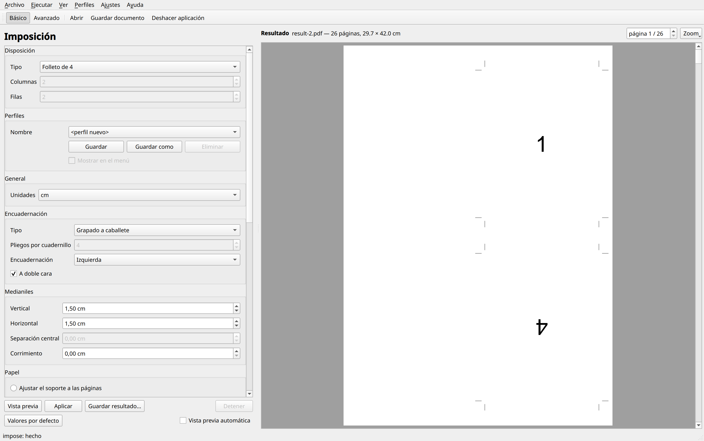
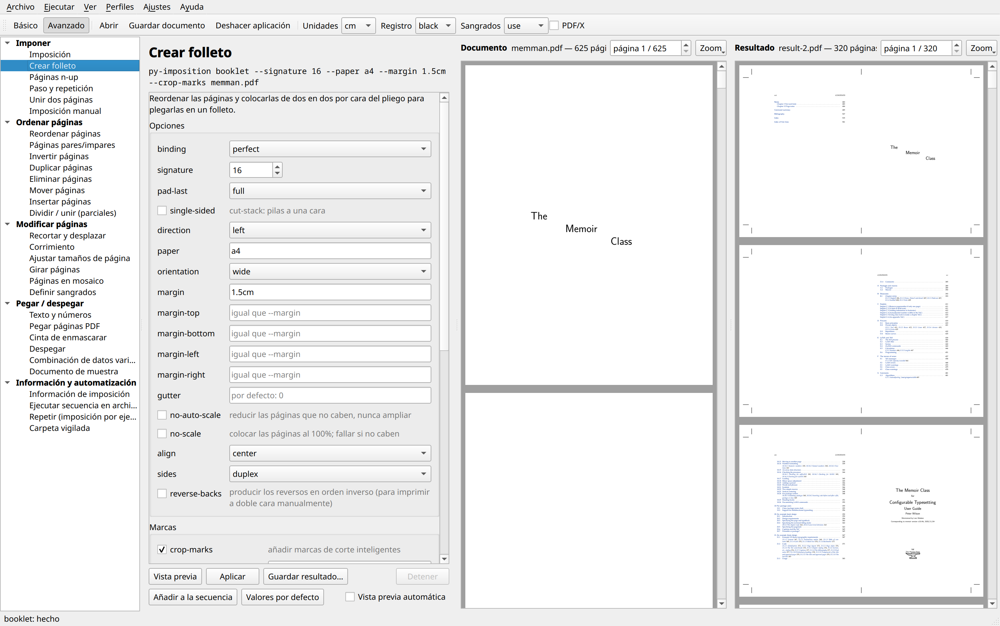
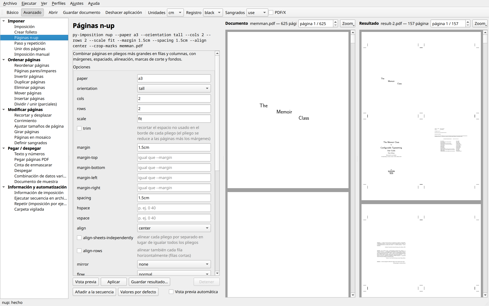
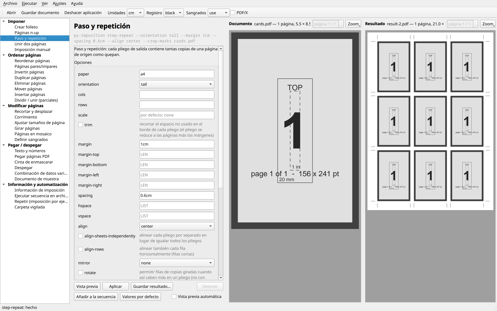
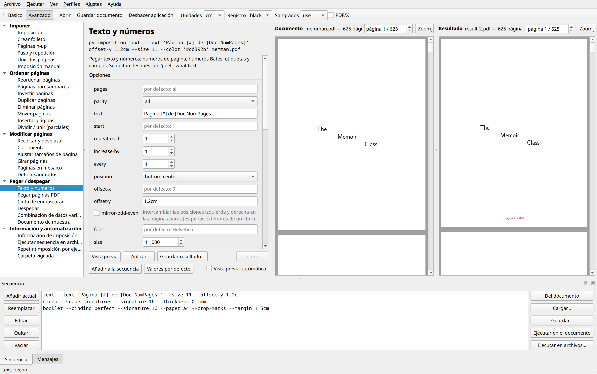
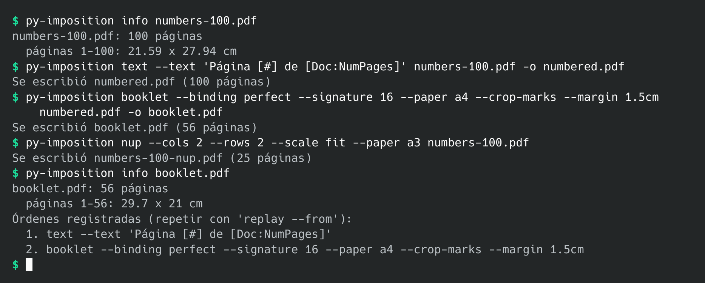

# py-imposition

*(English: [README.md](README.md))*

Un conjunto de herramientas de imposición de PDF, con una ventana y una
línea de órdenes: folletos, n-up, paso y repetición, reordenación de páginas,
recorte y desplazamiento, corrimiento, sangrados, números de página y sellos,
cinta de enmascarar, imposición manual, combinación de datos variables,
dividir/unir (parciales), secuencias de automatización y carpetas vigiladas.

- **La ventana** (`py-imposition-gui`) muestra el resultado a medida que se
  cambian las opciones. Su **modo básico** es un único formulario de
  imposición con las opciones habituales (disposición, encuadernación,
  medianiles, papel, márgenes, recorte de páginas, marcas de impresión) y
  perfiles guardados; su **modo avanzado** tiene todas las órdenes, las
  encadena, y arma y ejecuta secuencias. Véase [Interfaz gráfica](#interfaz-gráfica).
- **La línea de órdenes** (`py-imposition`) tiene las mismas órdenes, para
  scripts, lotes y carpetas vigiladas. Véase [Órdenes](#órdenes).

Ambas leen un PDF y escriben uno nuevo; nada cambia el original. Las órdenes
pueden encadenarse, una tras otra o guardadas como una **secuencia** que se
ejecuta de una sola vez. La interfaz está en inglés o en español. Cómo se
hizo se cuenta en [`docs/DESCRIPCIÓN_es.md`](docs/DESCRIPCIÓN_es.md).

## Capturas de pantalla

La ventana en modo básico: un único formulario de imposición, aquí un folleto
de 4 grapado a caballete de [`docs/example/numbers-100.pdf`](docs/example/README.md):



En modo avanzado, la ventana, haciendo un folleto de encuadernación encolada en cuadernillos de
16 páginas a partir del documento de ejemplo
([`docs/example/numbers-100.pdf`](docs/example/README.md)):



4-up en A3 con marcas de corte:



Paso y repetición (nueve copias de una página en A4):



Añadir números de página, con una secuencia de órdenes lista en el panel
Secuencia:



La línea de órdenes:



Estas imágenes se hacen con `uv run python tools/screenshots.py` (véase
[Desarrollo](#desarrollo)).

## Instalación

Hay tres formas de instalarlo: la AppImage (no hay nada que instalar), el
paquete de Fedora, o desde el código fuente.

### AppImage (cualquier Linux)

Descargue `py-imposition-VERSION-x86_64.AppImage` de las
[versiones publicadas](https://github.com/nivaca/py-imposition/releases),
hágala ejecutable y ejecútela. Lleva su propio Python, Qt y todo lo demás, y
funciona en Linux con glibc 2.34 o posterior (Ubuntu 22.04, Debian 12, Fedora
35 y posteriores).

```bash
chmod +x py-imposition-*-x86_64.AppImage
./py-imposition-*-x86_64.AppImage                    # la ventana
./py-imposition-*-x86_64.AppImage booklet in.pdf     # la línea de órdenes
./py-imposition-*-x86_64.AppImage cli --help         # la lista de órdenes
```

Un primer argumento que sea una orden (`booklet`, `nup`…), una opción o `cli`
ejecuta la línea de órdenes; cualquier otra cosa, o nada, abre la ventana.
Herramientas como AppImageLauncher o Gear Lever la añaden al menú de
aplicaciones.

### Fedora (Copr)

```bash
sudo dnf copr enable nivaca/py-imposition
sudo dnf install py-imposition
```

Esto instala `py-imposition`, `py-imposition-gui`, una entrada de menú
(ofrecida también para abrir archivos PDF) y los iconos, con el Python,
pikepdf, reportlab y PySide6 del propio Fedora. Las actualizaciones llegan con
`sudo dnf upgrade`. Los paquetes los construye y firma
[Copr](https://copr.fedorainfracloud.org/coprs/nivaca/py-imposition/).

Cada versión publicada incluye además el RPM, firmado con la clave del autor,
y esa clave (`RPM-GPG-KEY-py-imposition`, también en el repositorio como
[`packaging/RPM-GPG-KEY-py-imposition`](packaging/RPM-GPG-KEY-py-imposition)).
Su huella es `8187 0643 CA22 1AF9 0C30 554E BE68 32CD 3599 4948` (desde la 0.8; los RPM
de las versiones anteriores se firmaron con `1C16 55FF C029 6282 8A87 315E E750 A4F9 6998 9DA6`):

```bash
sudo rpm --import RPM-GPG-KEY-py-imposition
sudo dnf install ./py-imposition-*.noarch.rpm
```

### Desde el código fuente

Se necesita Python 3.13 o posterior y [uv](https://docs.astral.sh/uv/).

```bash
git clone https://github.com/nivaca/py-imposition.git    # o https://codeberg.org/nivaca/py-imposition.git
cd py-imposition
uv sync
uv tool install .        # opcional: hace que `py-imposition` esté disponible en todas partes
```

Para la interfaz gráfica, incluya el extra `gui`:

```bash
uv sync --extra gui
uv tool install '.[gui]'   # instala py-imposition y py-imposition-gui
```

Dependencias: [pikepdf](https://pikepdf.readthedocs.io/) (basado en QPDF)
y [reportlab](https://www.reportlab.com/) (texto y fuentes). La interfaz
gráfica necesita además [PySide6](https://doc.qt.io/qtforpython-6/) (Qt 6):
los paquetes `pyside6-essentials` y `pyside6-pdf`, unos 250 MB.

### Una entrada de menú

Si quiere abrir la ventana desde el menú de aplicaciones, ejecute una vez

```bash
py-imposition-install          # o: uv run py-imposition-install, python -m py_imposition.install
```

Eso añade una entrada, con el icono del programa, que abre la ventana con el
mismo Python que ejecutó el instalador. Dónde queda depende del sistema:

* **Linux** (y otros sistemas con menús freedesktop): en el menú de
  aplicaciones, como un archivo `.desktop` e iconos en `~/.local/share`. La
  entrada ofrece además py-imposition en el menú *Abrir con* de los archivos
  PDF.
* **Windows:** en el menú Inicio, como un acceso directo.
* **macOS:** en `~/Applications`, como una pequeña aplicación.

No requiere permisos de administrador. Si el entorno de Python se mueve o se
reconstruye (por ejemplo, tras volver a ejecutar `uv tool install` en otro
lugar), ejecútelo de nuevo. Necesita el extra `gui`, y lo indica si falta
PySide6.

### Desinstalación

```bash
py-imposition-install --uninstall   # quita la entrada de menú y sus iconos
uv tool uninstall py-imposition     # si se instaló con uv tool
```

`--uninstall` quita solo lo que añadió el instalador: la entrada y los iconos
`py-imposition` de todos los tamaños. Qt guarda los ajustes de la ventana en
`~/.config/py-imposition/` (Linux), el registro (Windows) o
`~/Library/Preferences` (macOS); bórrelos también si lo desea.

## Primeros pasos

El repositorio incluye un documento con el que hacer pruebas:
[`docs/example/numbers-100.pdf`](docs/example/README.md), 100 páginas que
muestran cada una su propio número, de modo que el orden de las páginas de
cualquier imposición se comprueba de un vistazo.

**En la ventana**, ábralo (desde el menú de aplicaciones, con *Archivo ▸
Abrir…* o soltándolo en la ventana), elija una disposición en el modo básico
y mire la vista previa; *Guardar…* escribe el PDF impuesto:

```bash
py-imposition-gui docs/example/numbers-100.pdf     # o la AppImage, con el archivo como argumento
```

**En la línea de órdenes:**

```bash
py-imposition info docs/example/numbers-100.pdf
py-imposition impose --layout 4up-booklet --binding saddle --media a3 --orientation portrait docs/example/numbers-100.pdf
py-imposition booklet --signature 16 --paper a4 --crop-marks --margin 1.5cm docs/example/numbers-100.pdf
```

En general:

```bash
# folleto 2-up con los ajustes por defecto
# (encuadernación encolada, 4 páginas por cuadernillo, encuadernación a la izquierda, Legal apaisado, sin márgenes, escala automática)
py-imposition input.pdf                      # escribe input-booklet.pdf

# cualquier orden: py-imposition COMMAND [options] INPUT [-o OUTPUT]
py-imposition booklet --binding saddle --paper a4 input.pdf -o booklet.pdf
py-imposition nup --cols 2 --rows 2 --scale fit --crop-marks input.pdf
py-imposition text --text "Page [#] of [Doc:NumPages]" input.pdf

py-imposition --help                 # lista las órdenes
py-imposition booklet --help         # opciones de una orden
```

Sin `-o`, el resultado va a `<input>-<command>.pdf`. Las órdenes que
producen varios documentos (por ejemplo, `--sides separate`) añaden un
sufijo como `-fronts`/`-backs`.

## Interfaz gráfica

```bash
py-imposition-gui [file.pdf]        # o: uv run py-imposition-gui
```

Un selector arriba a la izquierda de la ventana elige entre dos modos; la
ventana recuerda el último.

**El modo básico** es un único formulario de imposición con las opciones
habituales, dispuesto como un diálogo de imposición corriente. Ejecuta la
orden [`impose`](#impose--imposición):

- **Disposición:** el tipo (folleto de 2, de 4 o de 8, corte y apilado,
  secuencial, paso y repetición), y las columnas y filas de los tres últimos.
- **Perfiles:** guardar los ajustes con un nombre (*Guardar*, *Guardar
  como*), *Eliminarlos*, y marcar *Mostrar en el menú* para poner un perfil en
  el menú *Perfiles* y acceder a él rápidamente.
- **General:** las unidades.
- **Encuadernación:** grapado a caballete o encuadernación encolada, los
  pliegos por cuadernillo, el borde de encuadernación (izquierda o derecha) y
  *A doble cara*.
- **Medianiles:** vertical, horizontal, la separación central entre las
  columnas del medio de un folleto de 8, y el corrimiento.
- **Papel:** *Ajustar el soporte a las páginas* (el pliego se ajusta a las
  páginas), o *Ajustar al tamaño del soporte* con un tamaño estándar o
  personalizado y orientación vertical o apaisada; *Giro automático* y
  *Escala automática* (reducir las páginas demasiado grandes) y *Ampliar*
  (ampliar también las páginas pequeñas para llenar su lugar).
- **Márgenes:** superior, inferior, izquierdo y derecho. Los márgenes y los
  medianiles pueden ser negativos: las páginas se salen entonces de los
  bordes del pliego o se solapan, y se cortan en el borde o en la mitad del
  solapamiento.
- **Recorte de páginas:** recortar esta cantidad de los bordes de cada
  página (sus márgenes en blanco), para que su contenido ocupe más del
  pliego; con *Ampliar*, las páginas crecen hasta llenar su lugar.
- **Marcas de impresión:** marcas de corte, de sangrado y de registro, e
  información de página.

Las opciones que no se aplican a la disposición elegida aparecen en gris. Las
vistas previas, *Aplicar*, *Deshacer aplicación* y el guardado funcionan como
en el modo avanzado.

En ambos modos:

- **Guardar…** (Ctrl+S) guarda lo que muestra el panel de la derecha: el
  resultado de la orden actual sobre el documento actual. Si la vista previa
  no está al día (o todavía no hay ninguna), primero se ejecuta la orden.
  Cuando una orden produce varios archivos (anversos y reversos, por
  ejemplo), se guardan todos, con un sufijo. *Archivo ▸ Guardar el documento
  tal como está…* (Ctrl+Mayús+S) guarda en cambio el documento actual: las
  órdenes aplicadas hasta ahora, sin la actual.
- **Cambios sin guardar:** cuando se han aplicado órdenes, o se han cambiado
  opciones y se ha hecho un resultado, desde que se abrió o se guardó el
  documento, la barra de título muestra un asterisco. Al cerrar la ventana,
  abrir otro documento o volver al original, se pregunta antes si se desea
  guardar.
- *Archivo ▸ Abrir reciente* muestra los últimos diez documentos abiertos
  (*Vaciar la lista* la vacía).

**El modo avanzado** ofrece todas las órdenes de la línea de órdenes:

- **Las órdenes** aparecen a la izquierda, agrupadas como las secciones de
  más abajo.
- **Las opciones** de la orden elegida aparecen en un formulario generado a
  partir de las mismas definiciones que la línea de órdenes, de modo que los
  nombres, los valores por defecto y la ayuda (en las descripciones
  emergentes) coinciden. La línea de órdenes equivalente se muestra encima
  del formulario; cópiela con *Ejecutar ▸ Copiar línea de órdenes*. Las
  opciones que se excluyen entre sí se borran mutuamente. *Referencia*
  despliega los formatos de los archivos de disposición, de campos y de
  secuencia para `manual`, `merge-data` y `run`.
- **Vistas previas:** el resultado se muestra a la derecha. *Ver ▸ Mostrar el
  documento original* muestra además el documento actual a su lado; está
  desactivado por defecto, y la elección se guarda en el archivo de
  configuración (`show_document` en `config.toml`, véase
  [El idioma de la interfaz](#el-idioma-de-la-interfaz)). Con *Vista previa
  automática* activada, el resultado se
  actualiza poco después de cada cambio. Una lista desplegable pasa de un
  resultado a otro cuando una orden produce varios archivos (p. ej.,
  anversos y reversos por separado).
- **Aplicar** convierte el resultado en el documento actual, para que pueda
  encadenar órdenes (numerar las páginas, luego hacer un folleto, luego
  añadir marcas de corte…). *Deshacer aplicación* (Ctrl+Z) retrocede un
  paso, y *Archivo ▸ Volver al original* empieza de nuevo. Después de
  aplicar, el panel de la derecha muestra el documento tal como está, hasta
  que se vuelvan a cambiar las opciones.
- **Las preferencias** (unidades, color de registro, tratamiento de los
  sangrados, PDF/X) están en la barra de herramientas y se aplican a todas
  las órdenes. El idioma está en *Ajustes ▸ Idioma de la interfaz*.
- **Panel Secuencia:**
  - Reúna pasos desde el formulario (*Añadir actual*), o cambie su orden
    arrastrándolos.
  - Cargue pasos a partir de las órdenes registradas en un documento (*Del
    documento*, es decir, imposición por ejemplo).
  - Cargue y guarde archivos de secuencia.
  - Ejecute los pasos sobre el documento actual (con vista previa), o sobre
    un lote de archivos.
- **Información, ejecución y carpetas vigiladas:** *Información de
  imposición* abre un informe, y *Carpeta vigilada* inicia y detiene un
  proceso `watch`. Todas las órdenes se ejecutan en un proceso en segundo
  plano, así que la ventana sigue respondiendo. *Detener* (Esc) cancela una
  ejecución, y la pestaña *Mensajes* muestra cada línea de órdenes y su
  salida.
- Suelte un PDF sobre la ventana para abrirlo. La disposición de la ventana,
  las preferencias, las opciones de cada orden y la secuencia se recuerdan
  de una sesión a otra.

## El idioma de la interfaz

py-imposition habla inglés o español: la ayuda de cada orden y opción, sus
mensajes, y los menús, botones, etiquetas y ayuda de la ventana. Los
resultados (los PDF) son los mismos en ambos.

- **Para elegir el idioma de forma permanente:** ejecute
  `py-imposition interface es` (o `en`), o use *Ajustes ▸ Idioma de la
  interfaz* en la ventana. La ventana cambia al instante.
- **Al ejecutar `py-imposition interface` sin idioma** se listan los idiomas
  disponibles y se muestra el que está en uso.
- **Para una sola ejecución:** añada `--interface es` a cualquier orden.

La elección se guarda en un pequeño archivo de configuración, `config.toml`,
en `~/.config/py-imposition/` (Linux), `~/Library/Application
Support/py-imposition/` (macOS) o `%APPDATA%\py-imposition\` (Windows);
`$PY_IMPOSITION_CONFIG` indica otra carpeta. Tanto la línea de órdenes como
la ventana lo leen. La ventana guarda ahí también si muestra el documento
original (`show_document = true` o `false`).

Las traducciones están en `src/py_imposition/locale/es.xml`, con un `<text>`
para cada texto del programa, que da el inglés (`<en>`) y su traducción
(`<tr>`). Para añadir otro idioma, cree un archivo para él (`fr.xml`, por
ejemplo); lo que no traduzca se muestra en inglés. Los diálogos propios de
Qt, como los selectores de archivos, siguen el mismo idioma.

## Convenciones generales

**Las longitudes** llevan un sufijo de unidad: `5mm`, `1.5cm`, `0.25in`,
`12pt`. También sirven fracciones sencillas (`3/8in`). Los números sin
unidad usan la unidad actual, que es el centímetro salvo que `--units` diga
otra cosa.

**Los tamaños de papel** son nombres (`letter`, `legal`, `tabloid`,
`ledger`, `executive`, `statement`, `a0`–`a6`, `b4`, `b5`, `sra3`, y `max`
para 200 × 200 in) o tamaños explícitos (`21x29.7cm`, `9x14in`). La
orientación es `tall`/`portrait` (vertical), `wide`/`landscape` (apaisada),
`best` (n-up y paso y repetición eligen la que admita más páginas) o
`as-is` (tal cual).

**Los intervalos de páginas** tienen esta forma: `all`, `odd`, `even`,
`1-4,7`, `3..LAST`, `LAST-1`. `LAST` es la última página. Muchas órdenes
admiten también `--parity odd|even`.

**Las preferencias** las aceptan todas las órdenes:

| Opción | Significado |
|---|---|
| `--units cm\|mm\|in\|pt` | unidad de los números sin unidad (por defecto, `cm`) |
| `--registration black\|cmyk\|all` | color de las marcas de corte y del texto en "registro": solo negro, CMYK (las cuatro planchas de cuatricromía) o todas las separaciones |
| `--bleed use\|ignore` | usar las cajas de sangrado de las páginas al imponer (por defecto), o imponer solo la página visible |
| `--pdfx` | al quitar los sangrados, conservar una TrimBox (PDF/X) |
| `-q` | sin advertencias |
| `--interface en\|es` | el idioma de la interfaz, solo para esta ejecución (véase [El idioma de la interfaz](#el-idioma-de-la-interfaz)) |

**Cajas de página y sangrados.** La imposición alinea la *caja de corte* de
cada página. Si hay una caja de sangrado definida, el contenido se ve más
allá del corte. Los sangrados se recortan para que nunca invadan las páginas
vecinas, y las marcas de corte se alinean con el corte.

## Órdenes

### Imponer en pliegos

#### `impose` — Imposición

Todas las imposiciones habituales en una sola orden, con las opciones del modo
básico de la ventana:

| Opción | Descripción |
|---|---|
| `--layout 2up-booklet\|4up-booklet\|8up-booklet\|cut-stacks\|sequential\|step-repeat` | 2 páginas una al lado de otra; 2 filas de 2; 2 filas de 4; corte y apilado; páginas en orden; copias de cada página (por defecto: `2up-booklet`) |
| `--cols`, `--rows` | la cuadrícula de corte y apilado, secuencial y paso y repetición (por defecto: 2 × 2) |
| `--binding saddle\|perfect`, `--sheets-per-fold N` | grapado a caballete, o encuadernación encolada en cuadernillos de N pliegos plegados (por defecto: perfect, 4) |
| `--direction left\|right`, `--single-sided` | el borde de encuadernación; imprimir por una sola cara |
| `--gutter-v`, `--gutter-h`, `--spread`, `--creep` | espacio entre columnas y filas; entre las columnas del medio de un folleto de 8; corrimiento por el grosor del papel |
| `--media SIZE\|auto`, `--orientation portrait\|landscape` | el pliego: un nombre de papel o WxH, o `auto` para ajustarse a las páginas (por defecto: Legal apaisado) |
| `--auto-rotate`, `--no-auto-scale`, `--enlarge` | girar las páginas para que encajen en sus celdas; no reducir las páginas grandes; ampliar también las páginas pequeñas para llenar sus celdas |
| `--margin…` | márgenes; como los medianiles, pueden ser negativos (escriba `--margin=-1cm`): las páginas se salen entonces del pliego o se solapan, cortadas en el borde o en la mitad del solapamiento |
| `--page-trim…` | recortar esta cantidad de los bordes de cada página (los cuatro, o `--page-trim-top`, etc.), para dejar fuera sus márgenes en blanco |
| `--trim-marks`, `--bleed-marks`, `--registration-marks`, `--page-info` | marcas de impresión; la información de página es el nombre del documento, el número de pliego, la fecha y la hora |

Los folletos de 4 y de 8 usan las disposiciones de plegado habituales: se
pliega cada pliego y luego se encajan los pliegos plegados (grapado a
caballete) o se apilan en grupos de `--sheets-per-fold` (encuadernación
encolada).

```bash
py-imposition impose --layout 4up-booklet --binding saddle --media a3 --orientation portrait --trim-marks --margin 1.5 doc.pdf
py-imposition impose --layout step-repeat --cols 2 --rows 5 --media a4 --orientation portrait --trim-marks cards.pdf
py-imposition impose --media a4 --page-trim 1.5 --enlarge --margin=-0.3 doc.pdf   # texto más grande, menos blanco
```

#### `booklet` — Crear folleto

Reordena las páginas y pone dos en cada cara de un pliego para plegarlo.

| Opción | Descripción |
|---|---|
| `--binding perfect\|saddle\|continuous\|cut-stack` | **perfect**: cuadernillos plegados por separado y apilados (por defecto). **saddle**: todos los pliegos encajados en un solo pliegue (grapado a caballete). **continuous**: 1,2 \| 3,4 … (sin plegar). **cut-stack**: cortar los pliegos por la mitad y poner una pila sobre la otra. |
| `--signature N` (`--pages-per-fold`) | páginas por cuadernillo en la encuadernación encolada (múltiplo de 4, por defecto 4) |
| `--pad-last full\|multiple-of-4` | completar un último cuadernillo corto hasta su longitud entera, o solo hasta un múltiplo de 4 |
| `--single-sided` | pilas cortadas a una sola cara |
| `--direction left\|right` | borde de encuadernación (a la derecha para libros de derecha a izquierda) |
| `--paper SIZE`, `--orientation` | pliego (por defecto, Legal apaisado). `--paper auto` hace el pliego exactamente de dos páginas de ancho. |
| `--margin…`, `--gutter` | espacio en el borde del pliego, y entre las dos páginas |
| `--no-auto-scale` / `--no-scale` | no ampliar nunca / colocar al 100 % (falla si las páginas no caben) |
| `--align center\|fold` | centrar cada página en su mitad, o llevar las páginas hacia el pliegue/lomo |
| `--sides duplex\|flip-backs\|fronts-then-backs\|separate`, `--reverse-backs` | salida para impresoras de una sola cara: reversos cabeza abajo, todos los anversos y luego todos los reversos, o dos archivos |
| `--crop-marks` (+ opciones de marcas) | marcas de corte y de pliegue |

Todas las páginas se escalan por el mismo factor, basado en la página más
grande. Imprima el resultado a doble cara, volteando por el borde corto.

#### `nup` — Páginas n-up

Coloca las páginas de izquierda a derecha y de arriba abajo en pliegos más
grandes.

| Opción | Descripción |
|---|---|
| `--cols`, `--rows` | disposición: máximos al 100 %, o exacta con `--scale fit` |
| `--scale none\|fit\|PERCENT` | 100 %, ajustar exactamente columnas × filas (según la primera página), o un porcentaje |
| `--paper`, `--orientation best` | tamaño del pliego; `best` elige vertical o apaisado para que quepan más páginas |
| `--trim` | quitar el espacio sin usar en el borde de cada pliego |
| `--margin…`, `--spacing`, `--hspace "0 40"`, `--vspace` | márgenes, y espaciado entre columnas y filas. Las listas se repiten. |
| `--align top-left\|…\|center` | dónde se sitúan las páginas en los pliegos que no están llenos |
| `--align-sheets-independently`, `--align-rows` | alinear cada pliego por separado; alinear también las filas incompletas |
| `--mirror h\|v\|hv` | reflejar márgenes y alineación en los pliegos pares (reversos) |
| `--flow normal\|double\|double-flip` | llenar los pliegos uno tras otro, o alternar pliegos de anverso y reverso con los reversos en posiciones reflejadas (opcionalmente cabeza abajo) |
| `--crop-marks`, `--frames`, `--mark-offset/-length/-width`, `--mark-white-background` | marcas de corte inteligentes (nunca se superponen a las páginas y se convierten en marcas de pliegue donde hace falta), y marcos |
| `--background PDF`, `--background-pages`, `--background-mode repeat\|once\|repeat-last` | imponer sobre páginas de fondo (plantillas, barras de color) |

Una receta útil: `nup --cols 1 --rows 1 --paper max --trim --margin 1 --crop-marks`
añade márgenes y marcas de corte alrededor de cada página.

#### `step-repeat` — Paso y repetición

Llena cada pliego con copias de una página (tarjetas de visita, etiquetas).
Admite las mismas opciones de disposición que `nup`, más `--rotate`, que
añade filas de copias giradas cuando así caben más. Una tarjeta de
5 × 2 in en un pliego de 9 × 14 in da 7/8 copias (vertical/apaisado) sin
giro y 10/11 con él. Para que anversos y reversos coincidan, combine
`--rotate --align-rows --mirror h`.

#### `join` — Unir dos páginas

`--first N` une la página N con la N+1, una junto a otra; `--all` une cada
par. Los márgenes no cambian.

#### `manual` — Imposición manual

Coloca las páginas en posiciones exactas, según un archivo de disposición
TOML:

```toml
sheet = "a3"
orientation = "wide"
sides = "double-h"        # single | double-h | double-v (reversos reflejados automáticamente)
repeat = true             # repetir la disposición hasta colocar todas las páginas
crop_marks = true

[[place]]
side = "both"             # front | back | both (la página siguiente en el anverso, la posterior en el reverso)
corner = "top-left"       # los desplazamientos van de esta esquina del pliego a la misma esquina de la página
x = "2cm"
y = "2cm"
scale = 60                # porcentaje
rotate = 0                # en el sentido de las agujas del reloj
# page = 3                # página fija opcional en lugar de "la siguiente"
```

Admite también `background = "plate.pdf"` y `sheets = N` (pliegos por
ciclo), además de `--smart-marks` en la línea de órdenes. Véase
`py-imposition manual --help`.

### Ordenar páginas

#### `shuffle` — Reordenar páginas

Reordena y gira las páginas según una regla que se repite a lo largo del
documento. Normalmente va seguida de `nup`.

- `--rule` enumera los números de página de un grupo. `a..b` es un
  intervalo, `X` una página en blanco. Sufijos: `*` cabeza abajo, `>` 90° en
  el sentido de las agujas del reloj, `<` 90° en sentido contrario.
- `--group N` es el tamaño del grupo (por defecto, el número más alto de la
  regla).
- `--repeat normal` repite cada grupo (encuadernación encolada).
- `--repeat saddle`: la regla describe el primer pliego de un libro grapado
  a caballete y se extiende a cualquier longitud (`--rule "4 1 2 3"`).
- `--repeat cut-single`, `--repeat cut-double`: pilas cortadas impresas a
  una o a dos caras. Con `--consecutive A` y `--restart-after B` producen las
  "pilas avanzadas (A,B)", p. ej., talonarios numerados.

```bash
# folleto 4-up grapado a caballete: reordenar, luego n-up de 2 x 2
py-imposition shuffle --rule "8 1 5* 4* 2 7 3* 6*" --repeat saddle in.pdf -o s.pdf
py-imposition nup --cols 2 --rows 2 --scale fit --paper a3 s.pdf
```

#### `evenodd` — Páginas pares/impares

`--mode odds-first` (por defecto), `split` (dos archivos), `join --evens FILE`
(intercalar dos documentos) o `none`. Añada `--reverse-evens` y
`--rotate-evens` para imprimir manualmente a doble cara.

#### `reverse`, `duplicate`, `delete`, `move`

```bash
py-imposition reverse in.pdf
py-imposition duplicate --copies 2 [--no-collate] [--pages 1-3] in.pdf
py-imposition delete --pages "1,LAST" in.pdf
py-imposition move --pages 9-10 --before 1 in.pdf
```

#### `insert` — Insertar páginas

- **Qué:** `--blank N` o `--file PDF [--file-pages] [--copies] [--no-collate]`.
- **Dónde:** `--before`/`--after PAGE` (p. ej., `LAST-1`) o `--at start|end`.
- **Tamaño de las páginas en blanco:** `--size`/`--size-of`.
- **Intervalos:** `--every K` inserta, luego salta K páginas, y repite.
  `--each-time N` toma cada vez las N páginas siguientes del archivo.
- **Condiciones:** `--if` / `--unless` / `--until`, con `odd`, `even`,
  `lt:N`, `ge:N` o `multiple:N`.
- **Documento nuevo:** sin documento de entrada, crea uno.

```bash
# páginas en blanco antes de la contracubierta hasta que el número de páginas sea múltiplo de 4
py-imposition insert --blank 999 --after LAST-1 --until multiple:4 in.pdf
# insertar notes.pdf al final hasta llegar a un múltiplo de 32 páginas
py-imposition insert --file notes.pdf --copies 999 --until multiple:32 in.pdf
```

#### `split` — Dividir / unir (parciales)

Divide según `--by odd-even|list|equal|duplicates`, ejecuta órdenes
distintas en cada parte, y luego une las partes (`--merge`) o las conserva
como archivos separados.

```bash
# numerar cada parte de 16 páginas empezando otra vez por 1 (number.toml: steps = ["text"])
py-imposition split --by equal --size 16 --sequence number.toml --merge in.pdf
# parciales: disposiciones distintas para partes distintas
py-imposition split --by list --list "1..8; 9..16; 17..20" \
  --part-sequence 1=nup4x2.toml --part-sequence 2=nup4x2.toml --part-sequence 3=nup2x2.toml in.pdf
```

`--list` admite `LAST`, intervalos, sufijos de giro y `X`. Las órdenes de
cada parte vienen de `--sequence FILE` (todas las partes),
`--part-sequence N=FILE` o `--part-steps "N=cmd ...; cmd ..."`.

### Modificar páginas

#### `trim-shift` — Recortar y desplazar

- `--trim EDGE=LEN` y `--add EDGE=LEN` admiten left, right, top, bottom o
  all, y pueden repetirse.
- `--same-size SIZE` da a todas las páginas el mismo tamaño.
- `--shift DIR=LEN` desplaza una cantidad fija; `--shift-variable DIR=FIRST:LAST`
  varía el desplazamiento de la primera página a la última.
- `--mode improved` (por defecto) nunca deja al descubierto contenido
  recortado; `--mode original` mueve en cambio el origen de la página.
- `--keep-bleed` conserva los márgenes de sangrado.

Use `--pages`/`--parity` para los desplazamientos de encuadernación en las
páginas impares y pares.

#### `creep` — Corrimiento

Desplaza (o, con `--method scale`, comprime) el contenido de las páginas
para compensar el grosor del papel en los folletos plegados. Fije la
cantidad con `--thickness 0.1mm` o `--total 2mm`. Elija
`--scope document|signatures --signature N` y
`--shift-most inside|outside`. Ejecútelo antes de `booklet`.

#### `resize` — Ajustar tamaños de página

- **Objetivo:** `--size SIZE` (con `--orientation`), `--percent P` o
  `--same-as PAGE`.
- **Método:** `--method anamorphic|proportional|none`.
- **Otras opciones:** `--rotate-to-fit cw|ccw`, `--only enlarge|shrink`,
  `--similar TOL` (ajustar solo las páginas cercanas al tamaño objetivo), y
  `--keep-bleed` (anamórfico).
- **Comprobación:** `--verify` informa de las páginas de tamaño incorrecto
  sin cambiar nada.

#### `rotate`

`--angle 90|180|270` fija el giro de la página. Cualquier otro ángulo gira
libremente el contenido y agranda la página, salvo que indique
`--keep-size`. `--crop-first` recorta a la página visible antes de girar.
`--only tall|wide` atrapa páginas sueltas de otra orientación.

#### `tile` — Páginas en mosaico

- `--grid 2x1` divide cada página en una cuadrícula;
  `--sizes "4in 4.5in / 4in 3in"` usa tamaños de tesela exactos.
- `--overlap LEN` solapa las teselas, y `--overlap-bleed` convierte el
  solapamiento en sangrado.
- `--only-wide` divide solo las páginas dobles de lectura.
- `--undo-booklet saddle|perfect` corta un folleto 2-up impuesto y lo
  devuelve a páginas sueltas en orden de lectura.

#### `bleed` — Definir sangrados

- **Modos:** `--mode all|except-fold|edges|from-crop|remove|generate-only`.
  La cantidad es `--amount 3mm`, o `--left/--right/--top/--bottom` con
  `--mode edges`.
- **De dónde sale el sangrado:** del interior de la página visible por
  defecto, o `--outside` (de contenido recortado previamente).
- **Contenido ausente:** `--generate mirror|scale` crea contenido para la
  zona de sangrado, dibujado detrás de la página.
- **Visualización:** `--show` hace que la caja de recorte coincida con la
  caja de sangrado.

### Pegar elementos (y despegarlos)

#### `text` — Texto y números

```bash
py-imposition text in.pdf                                   # números de página, abajo en el centro
py-imposition text --text "Page [#] of [Doc:NumPages]" --position bottom-right --offset-x 1cm --mirror-odd-even in.pdf
py-imposition text --start 000123 --position top-right in.pdf     # numeración Bates, se conservan los ceros a la izquierda
py-imposition text --text "Plate [Page]" --color registration --registration all imposed.pdf
```

- **Marcadores:** `[#]` es el número. Campos: `[Doc:NumPages]`, `[Page]`,
  `[Date]`, `[Date:mdy]`, `[Date:iso]`, `[Time]`, `[DateTime]`,
  `[File:Name]`, `[File:Path]`, `[File:Folder]`, `[Doc:Title]`, `[Computer]`.
- **Numeración:** `--start`, `--repeat-each N` (1,1,1,2,2,2),
  `--increase-by N` (puede ser negativo), y `--every N` (estampar solo cada
  N páginas).
- **Posición:** `--position` (esquinas, arriba/abajo en el centro,
  izquierda, derecha, centro), `--offset-x` y `--offset-y` (medido hasta la
  línea de base del texto). `--rotation 0|90|180|270`.
- **Fuente:** `--font` es una fuente PDF estándar (Helvetica, Times-Roman,
  Courier…), un archivo TrueType o el nombre de una fuente instalada. Las
  fuentes instaladas se incrustan.
- **Tamaño y color:** `--size`. `--color` admite `black`, `red`, `#rrggbb`,
  `rgb:R,G,B`, `cmyk:C,M,Y,K` (porcentaje), `gray:P` o `registration`.

#### `stick-pdf` — Pegar páginas PDF

Añade páginas de otro PDF (logotipos, sellos, anuncios):

- `--file F --source-pages RANGE` elige las páginas de origen, que se van
  repitiendo sobre las páginas de destino.
- `--position`, `--offset-x/-y` las colocan, medido desde la esquina, el
  borde o el centro elegido.
- `--scale P` o `--fit WxH [--stretch]` fija el tamaño; `--rotate` las gira.
- `--under` las pone detrás del contenido de la página.

#### `mask` — Cinta de enmascarar

`--rect X,Y,W,H` (repetible) cubre zonas, medidas desde el
`--origin bottom-left|top-left` de la página visible, con el color `--color`
(blanco por defecto). Úsela para ocultar números de página antiguos antes
de añadir otros nuevos.

#### `peel` — Despegar texto y números, cinta de enmascarar o marcas de registro

`--what text|tape|marks|pdf|bleed|all` quita los elementos añadidos por esta
herramienta. Funciona incluso después de haber impuesto las páginas en
pliegos.

#### `merge-data` — Combinación de datos variables

Toma una fuente de datos CSV/TSV (separada por comas, punto y coma o
tabuladores, detectado automáticamente) y añade, por cada registro, texto,
bloques de texto (p. ej., etiquetas de correo) e imágenes (un número de
página de un PDF de imágenes):

```bash
# copiar una página maestra una vez por registro
py-imposition merge-data --master --data people.csv --fields fields.toml master.pdf
# o llenar páginas sucesivas: un registro cada N páginas
py-imposition merge-data --pages-per-record 2 --data people.csv --fields fields.toml doc.pdf
```

El archivo de campos usa marcadores `{Column Name}`:

```toml
[[text]]
template = "{Name} - {Company Name}"
position = "top-left"
x = "2cm"
y = "2cm"
size = 12

[[picture]]
file = "logos.pdf"
column = "Logo number"
position = "top-right"
fit = "3x2cm"

[[block]]
width = "8cm"
height = "4cm"
position = "bottom-left"
x = "2cm"
y = "2cm"
overflow = "scale"     # scale | cut | fail
lines = [
  { text = "{First name}" },
  { text = "{Last name}", same_line = true },
  { text = "{Address 2}", close_gap = true },
]
```

Los bloques de texto pueden fijar además `justify` (por bloque o por
línea), `font`, `size`, `color`, `rotation` y `warn_below`. Véase
`py-imposition merge-data --help`.

#### `sample` — Documento de muestra

`py-imposition sample --paper a4 --count 8` crea páginas de prueba grises
con un borde grueso, un número de página grande y líneas a 20 mm y a 1 in
de cada borde.

### Información y automatización

#### `info` — Información de imposición

Muestra los tamaños de página (agrupados), el giro, los márgenes de corte y
de sangrado, UserUnit, las anotaciones y las órdenes registradas en el
archivo. Añada `--json` para obtener una salida legible por máquina.

#### `run` — Secuencias de automatización

```toml
# booklet.toml
name = "numbered booklet"
units = "mm"                          # preferencias opcionales
steps = [
  "text --position bottom-center --offset-y 10",
  "booklet --paper legal --orientation wide",
]
```

```bash
py-imposition run --sequence booklet.toml a.pdf b.pdf c.pdf --out-dir out/
```

#### `replay` — Imposición por ejemplo

Cada resultado registra las órdenes que lo produjeron. `replay` las aplica a
otro documento, o las exporta como archivo de secuencia:

```bash
py-imposition replay --from finished-job.pdf next-job.pdf
py-imposition replay --from finished-job.pdf --export job.toml next-job.pdf
```

#### `watch` — Carpetas vigiladas

```bash
py-imposition watch incoming/ --sequence booklet.toml [--out DIR] [--done DIR] [--errors DIR] [--once]
```

Cada PDF que se deja en la carpeta se procesa cuando deja de crecer. Los
resultados van a `out/`, y los archivos de entrada se mueven a `done/` (o a
`errors/`, con un archivo de registro).

## Notas y limitaciones

- Los enlaces, los marcadores y los campos de formulario no sobreviven a
  la imposición. Las anotaciones no pasan a los
  pliegos impuestos.
- El texto usa las fuentes PDF estándar (no incrustadas) o fuentes TrueType
  (incrustadas). Las fuentes OpenType/CFF no son compatibles.
- Con `trim-shift --mode original` o `bleed --outside` puede dejar al
  descubierto contenido fuera de la página original, o no encontrar nada
  ahí.

## Desarrollo

```bash
uv sync --all-extras
uv run pytest            # las pruebas de la interfaz gráfica se ejecutan sin pantalla (QT_QPA_PLATFORM=offscreen) o se omiten sin PySide6
```

Las pruebas comprueban el orden de las páginas con ejemplos resueltos de
imposiciones habituales y ejecutan cada orden de principio a fin.
`tests/test_interface.py` comprueba además que cada texto del programa tenga
su traducción al español y que no quede ninguna traducción sin usar. El
código está en `src/py_imposition/`:

| Archivo | Contenido |
|---|---|
| `simple.py` | `impose`: todas las imposiciones habituales en una orden (lo que ejecuta el modo básico) |
| `impose.py` | folleto, n-up, paso y repetición, unir |
| `shuffle.py` | reglas de reordenación, pares/impares, invertir |
| `pagetools.py` | recortar/desplazar, corrimiento, cambio de tamaño, girar, duplicar/eliminar/mover, mosaico |
| `bleed.py`, `insert.py`, `stamp.py`, `manual.py`, `datamerge.py`, `split.py`, `info.py` | las órdenes correspondientes |
| `sequence.py` | run, replay, watch |
| `pdfutil.py` | cajas de página, colocación de páginas como Form XObjects, marcas de corte |
| `units.py`, `pagesel.py` | longitudes, tamaños de papel, intervalos de páginas |
| `common.py`, `runner.py` | estructura de las órdenes y línea de órdenes |
| `gui/` | la interfaz en PySide6: `basic.py` (modo básico: el formulario de imposición y sus perfiles), `forms.py` (formularios de opciones construidos a partir del analizador de la línea de órdenes), `preview.py` (visor de PDF), `window.py` (ventana principal, menús, documentos recientes, panel Secuencia, ejecución de procesos) |
| `install.py` | `py-imposition-install`: la entrada de menú en Linux, Windows y macOS |
| `interface.py`, `locale/` | el idioma de la interfaz: `tr()` traduce sus textos; `locale/es.xml` contiene el español |
| `config.py` | el archivo de configuración (`config.toml`): el idioma de la interfaz, y si la ventana muestra el documento original |
| `icons/` | el icono: `py-imposition.svg` y todos los tamaños hechos a partir de él |

### Herramientas

```bash
uv run python tools/screenshots.py [-o docs/img] [--only basic,booklet,nup,step-repeat,text,cli] [--langs en,es] [--scale 2] [--dark]
uv run python tools/icons.py [--dry-run]
```

- `tools/screenshots.py` hace las imágenes de este README y de `README.md`
  en `docs/img/`, en inglés y en español (`<shot>_en.png`,
  `<shot>_es.png`):
  - **La ventana** (`gui_<command>_<lang>.png`) se ejecuta sin pantalla con
    la plataforma offscreen de Qt. No aparece nada en pantalla, y el tamaño y
    la escala (2× por defecto, nítida en pantallas de alta resolución) no
    dependen de su monitor. Cada captura usa sus propios ajustes en una
    carpeta temporal, así que sus ajustes y su secuencia no se tocan. Todas
    las capturas usan [`docs/example/numbers-100.pdf`](docs/example/README.md).
  - **La línea de órdenes** (`cli_<lang>.png`) es una sesión real: se
    ejecutan las órdenes y su salida se dibuja como en una terminal.
  - Solo necesita el extra `gui`.
- `tools/icons.py` rehace todos los iconos a partir de
  `src/py_imposition/icons/py-imposition.svg`:
  - los tamaños hicolor de freedesktop y un SVG escalable;
  - el iconset y el `.icns` de macOS;
  - el `.ico` de Windows.

  Cada tamaño lo dibuja Inkscape (el Flatpak o el que esté en el `PATH`), y
  el `.ico` se ensambla con Pillow.

### Publicar una versión

Cada versión se publica con `tools/release.py`, que la publica en GitHub y en
Codeberg y, con `--rpm`, en Copr:

```bash
# 1. subir la versión en pyproject.toml, src/py_imposition/__init__.py y la spec:
rpmdev-bumpspec -n X.Y -c "What changed" -u "Nicolas Vaughan <nivaca@fastmail.com>" packaging/py-imposition.spec
# 2. hacer el commit, y luego:
uv run python tools/release.py --rpm --notes-file NOTES.md     # --dry-run para ver antes el plan
```

Muestra su plan y pregunta antes de ejecutarlo:

1. ejecuta las pruebas;
2. hace la wheel, el paquete fuente, la AppImage (`tools/bundle-appimage.py`)
   y el RPM firmado (`packaging/build-rpm.sh --sign`; gpg pide la frase de
   contraseña);
3. etiqueta la versión y sube `main` y la etiqueta a ambas forjas;
4. crea las versiones en GitHub y Codeberg con todos los archivos (la wheel,
   el paquete fuente, la AppImage, el RPM y su clave pública);
5. envía el RPM fuente firmado a Copr, que lo construye para cada Fedora.

`packaging/COPR.org` explica la configuración inicial (las herramientas, el
token de Copr, el proyecto) y los detalles. Las piezas pueden ejecutarse
también por separado: `uv run python tools/bundle-appimage.py` escribe la
AppImage en `dist/`, y `packaging/build-rpm.sh [--sign]` escribe los RPM en
`build/rpm/`.

## Licencia

Copyright (C) 2026 Nicolas Vaughan

Este programa es software libre: puede redistribuirlo y/o modificarlo según
los términos de la Licencia Pública General de GNU publicada por la Free
Software Foundation, ya sea la versión 3 de la Licencia o (a su elección)
cualquier versión posterior.

Este programa se distribuye con la esperanza de que sea útil, pero SIN
GARANTÍA ALGUNA; ni siquiera la garantía implícita de COMERCIABILIDAD o de
IDONEIDAD PARA UN PROPÓSITO PARTICULAR. Véase la [Licencia Pública General
de GNU](LICENSE) para más detalles.

Esta es una traducción no oficial, solo a título informativo: el texto que
rige es el de la Licencia Pública General de GNU en inglés, en el archivo
[LICENSE](LICENSE).
